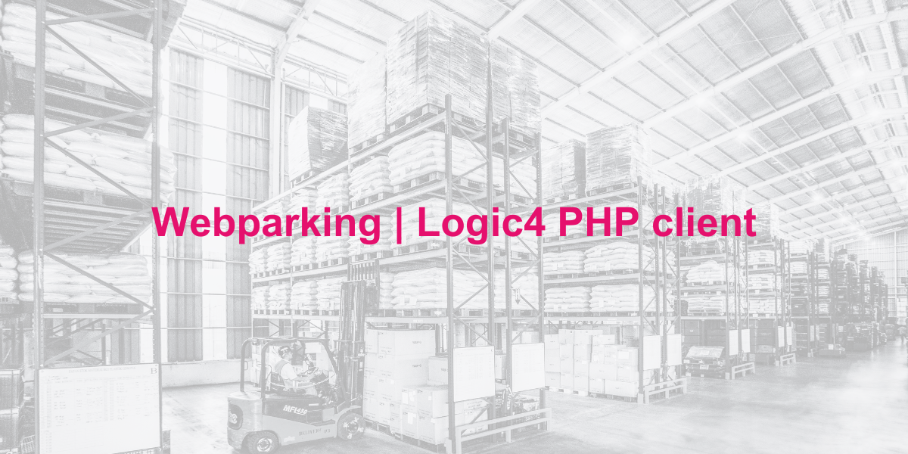

# Logic4 client

Unofficial PHP client for the Logic4 API. The request classes, response objects and endpoint reference are generated from Logic4's own OpenAPI documentation and checked for changes every day. The client covers Logic4 API v1.0 through v3.1, takes care of the OAuth access token and returns typed objects instead of raw arrays.

This package is not created or maintained by Logic4. For questions about Logic4 or its API, contact Logic4 support.

## Requirements

- PHP 8.3 or newer
- A [PSR-16](https://www.php-fig.org/psr/psr-16/) cache implementation to store the access token
- Laravel is optional; the client works in any PHP application

## Installation

```bash
composer require webparking/logic4-client
```

Beta builds generated from Logic4's QA environment are published as prereleases:

```bash
composer require webparking/logic4-client:4.1.0-beta.1
```

## Quick start

Any PSR-16 cache works for the access token. This example uses `symfony/cache`:

```php
use Symfony\Component\Cache\Adapter\FilesystemAdapter;
use Symfony\Component\Cache\Psr16Cache;
use Webparking\Logic4Client\AccessTokenManager;
use Webparking\Logic4Client\ClientFactory;
use Webparking\Logic4Client\Requests\V11\ProductRequest;

$tokenManager = new AccessTokenManager(new Psr16Cache(new FilesystemAdapter()));
$tokenManager->configure([
    'public_key' => $_ENV['LOGIC4_PUBLIC_KEY'],
    'company_key' => $_ENV['LOGIC4_COMPANY_KEY'],
    'username' => $_ENV['LOGIC4_USERNAME'],
    'secret_key' => $_ENV['LOGIC4_SECRET_KEY'],
    'password' => $_ENV['LOGIC4_PASSWORD'],
    'administration_id' => $_ENV['LOGIC4_ADMINISTRATION_ID'],
]);

$products = new ProductRequest(new ClientFactory($tokenManager));

foreach ($products->getProducts(['DebtorId' => 1]) as $product) {
    echo $product->productId, \PHP_EOL;
}
```

Every request class lives in a namespace named after the Logic4 API version it talks to: `Requests\V11\ProductRequest` calls `/v1.1/Products/...` and `Requests\V30\ProductRequest` calls `/v3/Products/...`. Pick the highest version that has the endpoint you need. See [Choosing an API version](docs/api-versions.md).

## Laravel

Laravel binds `Psr\SimpleCache\CacheInterface` to your default cache store, so the container can build `AccessTokenManager` on its own. Supply the credentials once, in the `register()` method of a service provider:

```php
use Illuminate\Support\ServiceProvider;
use Webparking\Logic4Client\AccessTokenManager;

final class Logic4ServiceProvider extends ServiceProvider
{
    public function register(): void
    {
        $this->app->afterResolving(AccessTokenManager::class, static fn (AccessTokenManager $tokenManager) => $tokenManager->configure([
            'public_key' => config('services.logic4.public_key'),
            'company_key' => config('services.logic4.company_key'),
            'username' => config('services.logic4.username'),
            'secret_key' => config('services.logic4.secret_key'),
            'password' => config('services.logic4.password'),
            'administration_id' => config('services.logic4.administration_id'),
        ]));
    }
}
```

Request classes can then be injected anywhere:

```php
use Webparking\Logic4Client\Requests\V11\ProductRequest;

final class ProductController
{
    public function __invoke(ProductRequest $products): array
    {
        return iterator_to_array($products->getProducts(['DebtorId' => 1]));
    }
}
```

The full setup, including `config/services.php`, is in [Getting started](docs/getting-started.md).

## Responses

Endpoint methods return one of three shapes. The method signature and its `@return` docblock tell you which.

| Shape | Where | Example | How to read it |
| --- | --- | --- | --- |
| `\Generator<DTO>` | Paginated lists in V10 to V20 | `V11\ProductRequest::getProducts()` | `foreach` over it. Pages of 1000 records load as you go. `iterator_to_array()` loads everything. |
| `*Logic4ResponseList` | Other lists in V10 to V20 | `V10\ProductGroupsRequest::getProductGroups()` | `->records`, `->recordsCounter`, `->validationMessages` |
| `array`, `string`, `int`, `bool`, `void` or a single object | V30 and V31 | `V30\ProductRequest::getProducts()` | Plain PHP values. Objects live in `Responses\V30`. |

Details and pagination options are in [Responses](docs/responses.md).

## Errors

Every HTTP status of 400 or higher becomes a `Logic4ApiException`, with the Guzzle exception attached as `previous`:

```php
use Webparking\Logic4Client\Exceptions\Logic4ApiException;

try {
    $groups = $request->getProductGroups(['IsTopLevelGroup' => true]);
} catch (Logic4ApiException $exception) {
    report($exception->getPrevious() ?? $exception);
}
```

Transport failures, token failures and validation messages are covered in [Errors](docs/errors.md).

## Testing your integration

Give a request class a mocked Guzzle client with `setClient()`, or enable `ClientFactory::preventStrayRequests()` in your test case so every unmocked call throws. Examples for Mockery, Guzzle's `MockHandler` and Laravel are in [Testing](docs/testing.md).

## Documentation

- [Getting started](docs/getting-started.md): credentials, plain PHP and Laravel setup, request lifecycle
- [Choosing an API version](docs/api-versions.md): what the `V10` to `V31` namespaces mean and which ones still change
- [Responses](docs/responses.md): generators, envelopes, plain values, pagination
- [Errors](docs/errors.md): exceptions, validation messages, retries
- [Configuration](docs/configuration.md): every constructor argument, cache behaviour, QA environment
- [Testing](docs/testing.md): mocking patterns for your own test suite
- [Endpoint reference](docs/endpoints/README.md): every request class and method per API version
- [Changelog](CHANGELOG.md) and [upgrade guide](UPGRADE.md)
- Logic4's own API documentation: [production](https://api.logic4server.nl/scalar/) and [QA](https://qa.api.logic4server.nl/scalar/)

## Contributing

Bug reports and pull requests are welcome. [CONTRIBUTING.md](CONTRIBUTING.md) explains the development environment, the generator and the release process. Security issues go through [SECURITY.md](SECURITY.md).

The client only follows what Logic4 documents. Open an issue when a documented endpoint is missing or generated incorrectly; requests for new Logic4 functionality belong with Logic4 itself.

## License

The MIT License (MIT). Please see the [license file](LICENSE.md) for more information.
