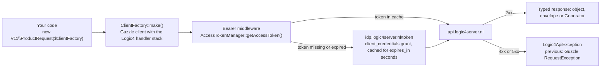

# Getting started

This page takes you from credentials to a first successful request. It assumes you have installed the package with `composer require webparking/logic4-client` on PHP 8.3 or newer.

## How the pieces fit together



Three classes do the work:

- `AccessTokenManager` turns your credentials into an OAuth access token and keeps it in a PSR-16 cache until it expires.
- `ClientFactory` builds a Guzzle client that adds the bearer token to every request and converts error responses into `Logic4ApiException`.
- A request class such as `Requests\V11\ProductRequest` exposes one method per Logic4 endpoint and maps the JSON answer onto typed objects.

## Credentials

Logic4 provides six values for an API user. They are secrets, so keep them in environment variables.

| `configure()` key | Environment variable used in these docs |
| --- | --- |
| `public_key` | `LOGIC4_PUBLIC_KEY` |
| `company_key` | `LOGIC4_COMPANY_KEY` |
| `username` | `LOGIC4_USERNAME` |
| `secret_key` | `LOGIC4_SECRET_KEY` |
| `password` | `LOGIC4_PASSWORD` |
| `administration_id` | `LOGIC4_ADMINISTRATION_ID` |

All six keys are required.

## Plain PHP

Any `Psr\SimpleCache\CacheInterface` implementation works as token cache. This example uses `symfony/cache`:

```php
use Symfony\Component\Cache\Adapter\FilesystemAdapter;
use Symfony\Component\Cache\Psr16Cache;
use Webparking\Logic4Client\AccessTokenManager;
use Webparking\Logic4Client\ClientFactory;
use Webparking\Logic4Client\Requests\V11\ProductRequest;

$cache = new Psr16Cache(new FilesystemAdapter());

$tokenManager = new AccessTokenManager($cache);
$tokenManager->configure([
    'public_key' => $_ENV['LOGIC4_PUBLIC_KEY'],
    'company_key' => $_ENV['LOGIC4_COMPANY_KEY'],
    'username' => $_ENV['LOGIC4_USERNAME'],
    'secret_key' => $_ENV['LOGIC4_SECRET_KEY'],
    'password' => $_ENV['LOGIC4_PASSWORD'],
    'administration_id' => $_ENV['LOGIC4_ADMINISTRATION_ID'],
]);

$clientFactory = new ClientFactory($tokenManager);
$products = new ProductRequest($clientFactory);
```

Create one `AccessTokenManager` and one `ClientFactory` per administration and share them between request classes. A request class builds its Guzzle client on first use and keeps it for its lifetime.

## Laravel

Laravel binds `Psr\SimpleCache\CacheInterface` to your default cache store, so the container can construct `AccessTokenManager` without extra bindings. You only need to pass the credentials once.

Add them to `config/services.php`:

```php
return [
    'logic4' => [
        'public_key' => env('LOGIC4_PUBLIC_KEY'),
        'company_key' => env('LOGIC4_COMPANY_KEY'),
        'username' => env('LOGIC4_USERNAME'),
        'secret_key' => env('LOGIC4_SECRET_KEY'),
        'password' => env('LOGIC4_PASSWORD'),
        'administration_id' => env('LOGIC4_ADMINISTRATION_ID'),
    ],
];
```

Configure the token manager when the container resolves it. The `register()` method of `AppServiceProvider` or a dedicated provider is a fine place:

```php
use Illuminate\Support\ServiceProvider;
use Webparking\Logic4Client\AccessTokenManager;

final class Logic4ServiceProvider extends ServiceProvider
{
    public function register(): void
    {
        $this->app->afterResolving(AccessTokenManager::class, static fn (AccessTokenManager $tokenManager) => $tokenManager->configure([
            'public_key' => config('services.logic4.public_key'),
            'company_key' => config('services.logic4.company_key'),
            'username' => config('services.logic4.username'),
            'secret_key' => config('services.logic4.secret_key'),
            'password' => config('services.logic4.password'),
            'administration_id' => config('services.logic4.administration_id'),
        ]));
    }
}
```

Request classes can now be injected wherever the container builds objects:

```php
use Webparking\Logic4Client\Requests\V11\ProductRequest;

final class ProductController
{
    public function __invoke(ProductRequest $products): array
    {
        return iterator_to_array($products->getProducts(['DebtorId' => 1]));
    }
}
```

Because `AccessTokenManager` is resolved from the container, every request class in your application shares the same cached token.

## Your first request

```php
use Webparking\Logic4Client\Requests\V11\ProductRequest;

$products = new ProductRequest($clientFactory);

foreach ($products->getProducts(['DebtorId' => 1]) as $product) {
    echo $product->productId, \PHP_EOL;
}
```

`getProducts()` in V11 returns a `Generator` that fetches pages of 1000 products while you iterate. Other endpoints return envelope objects or plain values. [Responses](responses.md) explains all three shapes.

## Finding the right request class and method

Namespaces mirror Logic4 API versions: `Requests\V11\ProductRequest` calls `/v1.1/Products/...` and `Requests\V30\ProductRequest` calls `/v3/Products/...`. Method names follow the last segment of the endpoint path, so `/v1.1/Products/GetSuppliersForProduct` becomes `getSuppliersForProduct()`. The [endpoint reference](endpoints/README.md) lists every class and method per version, and [Choosing an API version](api-versions.md) explains which version to use.

Method docblocks describe every request parameter as an array shape, so your IDE and PHPStan can check the keys you pass. The descriptions are in Dutch because they are copied from Logic4's documentation.

## What happens on each call

1. The request class asks `ClientFactory` for a Guzzle client the first time it needs one.
2. The bearer middleware asks `AccessTokenManager` for a token. The token comes from the cache when present. Otherwise the manager posts a `client_credentials` grant to `https://idp.logic4server.nl/token` and caches the result for the `expires_in` seconds Logic4 reports.
3. The request goes to `https://api.logic4server.nl` with a 60 second timeout.
4. A status of 400 or higher becomes a `Logic4ApiException`. See [Errors](errors.md).
5. The JSON body is mapped onto the return type of the method.

Base URL, token URL, cache and Guzzle options can all be changed. See [Configuration](configuration.md).

## Next steps

- [Choosing an API version](api-versions.md)
- [Responses](responses.md)
- [Errors](errors.md)
- [Testing](testing.md)
